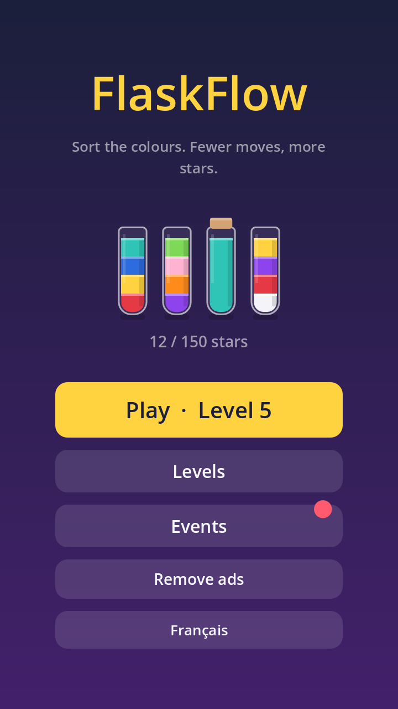
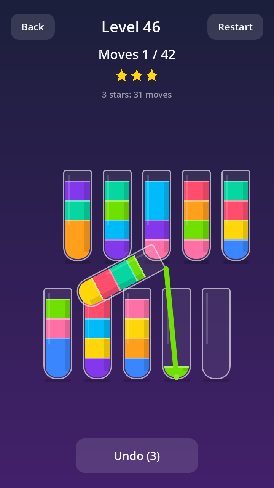
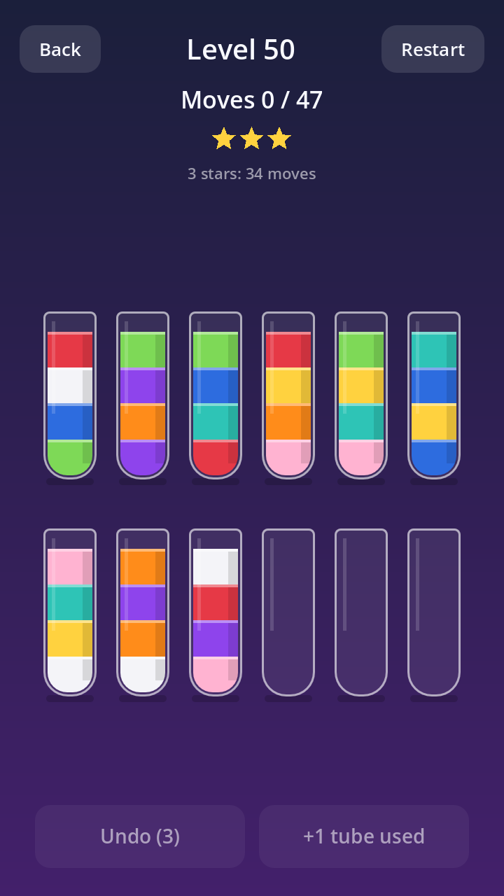
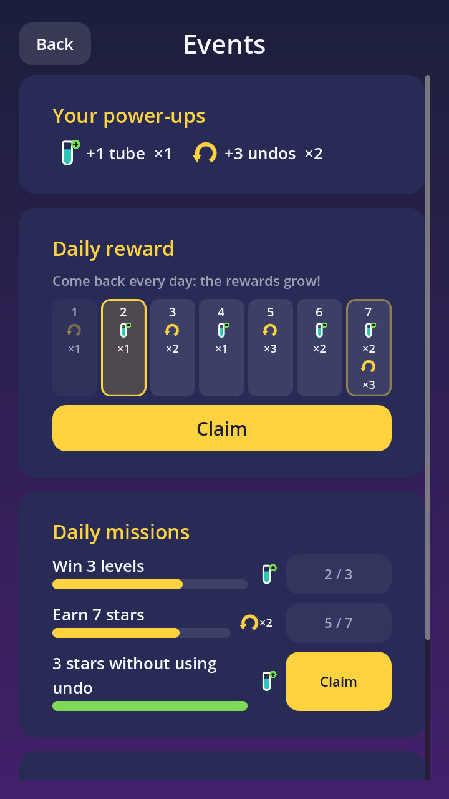

# FlaskFlow (nom provisoire)

Puzzle de tri de liquides pour Android, fait avec **Godot 4.5**.
Twist : **coups limités + étoiles**. Le nombre minimal de coups de chaque niveau est calculé par un solveur, et les étoiles sont attribuées en fonction.

| Menu | Versement | Tube complété | Tube en plus | Événements |
|---|---|---|---|---|
|  |  |  |  |  |

## Lancer le projet (Mac et PC)

1. Installe [Godot 4.5](https://godotengine.org/download), la version standard (pas .NET).
2. Ouvre Godot, clique sur **Importer** et sélectionne `project.godot`.
3. Appuie sur **F5** pour jouer. La fenêtre est au format portrait.

## Structure

```
data/levels.json            50 niveaux générés (couleurs, coups optimaux, seuils d'étoiles)
tools/generate_levels.py    générateur + solveur A* (optimal) → levels.json
scripts/board.gd            logique pure du jeu (verser, annuler, victoire)
scripts/autoload/
  game_state.gd             niveaux + sauvegarde (user://save.json)
  i18n.gd                   textes FR / EN (langue du téléphone par défaut)
  ads.gd                    AdMob + Google Play Billing (simulés sur PC)
  sfx.gd                    effets sonores
addons/                     plugins AdMob et Google Play Billing
assets/sfx/                 sons générés par tools/generate_sfx.py
scripts/screens/            menu, sélection des niveaux, écran de jeu
scripts/ui/                 dessin des tubes, étoiles, thème, palette
tests/run_tests.gd          tests automatiques (règles + parties jouées via l'UI)
```

## Règles

- Un tube contient 4 couches.
- On peut verser sur la même couleur ou dans un tube vide. Toutes les couches du dessus de cette couleur partent ensemble, dans la limite de la place disponible.
- Chaque niveau a une **limite de coups**. Les étoiles se gagnent ainsi :
  - 3 ★ au nombre optimal de coups, avec une petite marge (+1 environ),
  - 2 ★ avec une marge plus grande,
  - 1 ★ si le niveau est simplement réussi.
- **Boosters** :
  - 3 « annuler » gratuits par niveau. Ensuite, +3 avec un power-up, ou en regardant une pub récompensée.
  - **+1 tube vide**, une fois par niveau, avec un power-up ou une pub. Il est aussi proposé quand le joueur est bloqué.
  - « +5 coups » contre une pub, quand il n'y a plus de coups (une fois par niveau).

## Événements et power-ups

Il y a deux power-ups, `tube` et `undo` (+3 annulations). Ils sont stockés dans la sauvegarde, et le joueur en a 1 de chaque au départ.

- **Récompense quotidienne** : un calendrier de 7 jours, dont les récompenses augmentent chaque jour. Si le joueur rate un jour, il recommence au jour 1.
- **Missions du jour** : gagner 3 niveaux, gagner 7 étoiles, finir un niveau avec 3 étoiles sans annuler. Elles se remettent à zéro chaque jour.
- **Coffre à étoiles** : un coffre toutes les 15 étoiles.
- Un point rouge s'affiche sur le bouton « Événements » du menu quand quelque chose est à récupérer.

Les récompenses et les objectifs se règlent en haut de `scripts/autoload/game_state.gd` (`DAILY_REWARDS`, `MISSIONS`, `CHEST_STARS`).

## Générer plus de niveaux

```bash
python3 tools/generate_levels.py 100 2026 tests/solutions.json > data/levels.json
```

Arguments : nombre de niveaux, graine aléatoire, puis fichier de solutions pour les tests. La difficulté se règle dans `difficulty_for()` (nombre de couleurs selon le niveau) et dans `star_thresholds()`.

## Tests

```bash
godot --headless --path . -s tests/run_tests.gd
```

## Son

Les effets sonores sont **générés par code** avec `tools/generate_sfx.py` : versement, bouchon, sélection, erreur, victoire, étoiles, récompense, défaite. Il n'y a donc aucun fichier audio à acheter ni aucune licence à gérer. Pour modifier un son, change sa fonction dans le script, puis relance :

```bash
python3 tools/generate_sfx.py
```

On joue un son avec `Sfx.play("pour")`. Le son peut être coupé ou activé depuis le menu.

## Monétisation : AdMob + Google Play Billing

Les deux plugins officiels sont **déjà inclus** dans `addons/` et activés :

- AdMob v7.0 (`godot-sdk-integrations/godot-admob`)
- Google Play Billing 3.3.0 (`godot-sdk-integrations/godot-google-play-billing`)

Tout le code de monétisation se trouve dans `scripts/autoload/ads.gd`.

| | Sur PC / dans l'éditeur | Sur Android |
|---|---|---|
| Pubs | simulées (récompense donnée tout de suite) | vraies pubs AdMob (de **test** par défaut) |
| Achat « sans pub » | simulé | vrai achat Google Play |

Ce qui est en place :

- **Interstitiel** tous les 3 niveaux, sauf si le joueur a acheté « sans pub ».
- **Pub récompensée** pour +1 tube, +3 annulations ou +5 coups.
- **Consentement RGPD** : le formulaire Google UMP s'affiche avant toute pub dans l'UE.
- **Achat « remove_ads »** :
  - il est validé (acknowledge) automatiquement,
  - il est restauré au lancement,
  - un bouton « Restaurer les achats » est présent dans le menu,
  - le prix affiché est le prix local renvoyé par Google.

### Étape 1 : tester sur ton téléphone (pubs de test)

1. Dans Godot, va dans **Projet → Installer le modèle de compilation Android**. Il est nécessaire parce que les plugins utilisent la compilation Gradle.
2. Dans **Éditeur → Paramètres de l'éditeur → Export → Android**, renseigne le SDK Android (celui d'Android Studio) et un keystore de debug.
3. Branche ton téléphone, puis clique sur l'icône Android en haut à droite.

Tu dois voir des pubs marquées **« Test Ad »**. C'est normal et sans risque.

### Étape 2 : créer tes vrais identifiants AdMob

1. Sur [admob.google.com](https://admob.google.com), ajoute une application Android, puis crée 2 blocs d'annonces : **Interstitiel** et **Avec récompense**.
2. Dans `addons/AdmobPlugin/android_export.cfg`, mets ton **App ID** dans `[Release]` et passe `is_real = true`.
3. Dans `scripts/autoload/ads.gd`, passe `USE_REAL_ADS = true` et colle tes 2 IDs de blocs d'annonces.
4. ⚠️ Ne clique jamais sur tes propres vraies pubs : AdMob peut suspendre ton compte. Pour tester, garde les pubs de test.

### Étape 3 : l'achat « sans pub » dans la Play Console

1. Crée l'application dans la Play Console, avec le package `com.valastor.flaskflow`, celui défini dans `export_presets.cfg`.
2. Envoie un premier build AAB en **test interne**. La facturation ne s'active qu'après ce premier envoi.
3. Va dans **Monétiser → Produits → Produits intégrés** et crée le produit `remove_ads`. Donne-lui un prix, par exemple 2,99 €, puis **active**-le.
4. Ajoute ton compte Google dans **Paramètres → Test de licence**, pour acheter en mode test sans être débité.

## Export Android

Le preset Android est déjà configuré dans `export_presets.cfg` :

- compilation Gradle,
- format AAB,
- permissions Internet,
- package `com.valastor.flaskflow` (définitif une fois publié).

Il te reste trois choses à faire :

1. Télécharge les modèles d'export : **Éditeur → Gérer les modèles d'export**.
2. Installe le modèle de compilation Android : **Projet → Installer le modèle de compilation Android**.
3. Renseigne ton **keystore de release** dans **Projet → Exporter → Android**. Ne le perds jamais : sans lui, tu ne peux plus mettre à jour l'application.
