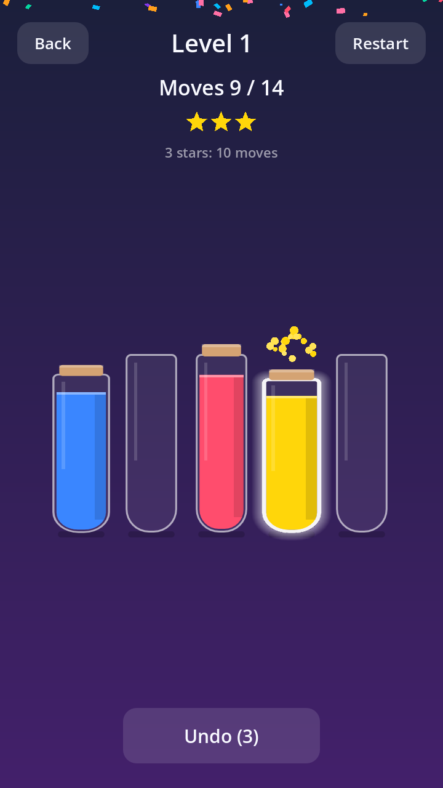

# FlaskFlow (nom provisoire)

Puzzle de tri de liquides pour Android, fait avec **Godot 4.5**.
Twist : **coups limités + étoiles**. Le nombre minimal de coups de chaque niveau est calculé par un solveur, et les étoiles sont attribuées en fonction.

| Menu | Versement | Tube complété | Tube en plus | Événements |
|---|---|---|---|---|
|  |  |  |  |  |

## Lancer le projet (Mac et PC)

1. Installe [Godot 4.5](https://godotengine.org/download), la version standard (pas .NET).
2. Ouvre Godot, clique sur **Importer** et sélectionne `project.godot`.
3. Appuie sur **F5** pour jouer. La fenêtre est au format portrait.

## Structure

```
data/levels.json            50 niveaux générés (couleurs, coups optimaux, seuils d'étoiles)
tools/generate_levels.py    générateur + solveur A* (optimal) → levels.json
scripts/board.gd            logique pure du jeu (verser, annuler, victoire)
scripts/autoload/
  game_state.gd             niveaux + sauvegarde (user://save.json)
  i18n.gd                   textes FR / EN (langue du téléphone par défaut)
  ads.gd                    pubs + achat « sans pub », SIMULÉS pour l'instant
scripts/screens/            menu, sélection des niveaux, écran de jeu
scripts/ui/                 dessin des tubes, étoiles, thème, palette
tests/run_tests.gd          tests automatiques (règles + parties jouées via l'UI)
```

## Règles

- Un tube contient 4 couches.
- On peut verser sur la même couleur ou dans un tube vide. Toutes les couches du dessus de cette couleur partent ensemble, dans la limite de la place disponible.
- Chaque niveau a une **limite de coups**. Les étoiles se gagnent ainsi :
  - 3 ★ au nombre optimal de coups, avec une petite marge (+1 environ),
  - 2 ★ avec une marge plus grande,
  - 1 ★ si le niveau est simplement réussi.
- **Boosters** :
  - 3 « annuler » gratuits par niveau. Ensuite, +3 avec un power-up, ou en regardant une pub récompensée.
  - **+1 tube vide**, une fois par niveau, avec un power-up ou une pub. Il est aussi proposé quand le joueur est bloqué.
  - « +5 coups » contre une pub, quand il n'y a plus de coups (une fois par niveau).

## Événements et power-ups

Il y a deux power-ups, `tube` et `undo` (+3 annulations). Ils sont stockés dans la sauvegarde, et le joueur en a 1 de chaque au départ.

- **Récompense quotidienne** : un calendrier de 7 jours, dont les récompenses augmentent chaque jour. Si le joueur rate un jour, il recommence au jour 1.
- **Missions du jour** : gagner 3 niveaux, gagner 7 étoiles, finir un niveau avec 3 étoiles sans annuler. Elles se remettent à zéro chaque jour.
- **Coffre à étoiles** : un coffre toutes les 15 étoiles.
- Un point rouge s'affiche sur le bouton « Événements » du menu quand quelque chose est à récupérer.

Les récompenses et les objectifs se règlent en haut de `scripts/autoload/game_state.gd` (`DAILY_REWARDS`, `MISSIONS`, `CHEST_STARS`).

## Générer plus de niveaux

```bash
python3 tools/generate_levels.py 100 2026 tests/solutions.json > data/levels.json
```

Arguments : nombre de niveaux, graine aléatoire, puis fichier de solutions pour les tests. La difficulté se règle dans `difficulty_for()` (nombre de couleurs selon le niveau) et dans `star_thresholds()`.

## Tests

```bash
godot --headless --path . -s tests/run_tests.gd
```

## Monétisation (étape suivante)

Pour l'instant, `scripts/autoload/ads.gd` simule tout. Le jeu appelle seulement ces fonctions :

- `Ads.on_level_completed()` : affiche un interstitiel tous les 3 niveaux, sauf si l'achat « sans pub » a été fait.
- `Ads.show_rewarded(callback)` : pub récompensée (annulations, +5 coups). Elle reste disponible même après l'achat « sans pub », parce que c'est le joueur qui choisit de la regarder.
- `Ads.purchase_remove_ads()` : achat non consommable « remove_ads ».

À faire : brancher le plugin AdMob pour Godot et le plugin Google Play Billing, valider l'achat (acknowledge sous 3 jours), ajouter « Restaurer les achats » et le consentement RGPD (UMP).

## Export Android

Dans Godot : **Éditeur → Gérer les modèles d'export → Télécharger**. Ensuite, **Projet → Exporter → Ajouter… → Android**. Il faut le SDK Android, que tu as déjà avec Android Studio, et un keystore de release. Pour le Play Store, exporte en **AAB**.
